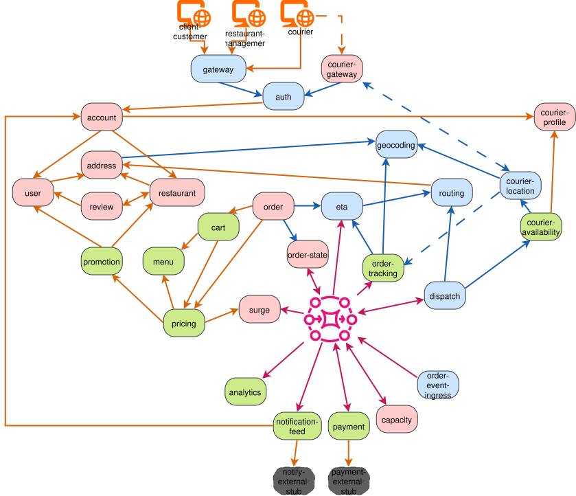

# PolyEats

A polyglot (Go, Java, Python) microservices benchmark for software architecture recovery (SAR) tools, built around a food-delivery system.
Ground truth ships as an annotated dependency graph: services, datastores and message destinations as nodes, typed endpoint-level edges labelled with the SAR pattern that obscures them and whether each is statically resolvable and/or observed at runtime. See [dataset/dataset-schema.md](dataset/dataset-schema.md).
A grader in [grading/](grading/) scores tool output against it.

## Proposed architecture



The diagram shows the target system. Not all services are implemented yet; the published dataset describes the current state.

## Layout

| Path | Contents |
|---|---|
| `services/` | The benchmark's microservices |
| `dataset/` | Published dependency graph + validation report and their schemas |
| `grading/` | Grader and naive baseline |
| `infra/` | Tooling (release stamping, canonicalisation) |
| `proto/` | gRPC definitions |
| `docs/` | Documentation and diagrams |

## Running it

```
docker compose up --build
```

Brings up the entire stack. Jaeger (traces) is available at [http://localhost:16686](http://localhost:16686).

Once everything is healthy, you can run the smoke test against the running stack:

```
python infra/workload/run.py
```

It exercises each service's `/health` and a few real endpoints, and exits non-zero on any unexpected status code.

## Grading

A submission is a JSON file listing the nodes and caller → callee edges your tool recovered:

```json
{
  "nodes": ["address", "geocoding", "db:address"],
  "edges": [
    {"caller": "address", "callee": "geocoding"},
    {"caller": "address", "callee": "db:address"}
  ]
}
```

Services are named after their folder in `services/`, datastores as `db:<name>` named after the service that owns them (`db:geocoding`). Every caller and callee must appear in `nodes`.

```
python grading/grader/grader.py results.json [--dbs]
```

Datastores are ignored unless `--dbs` is passed. The grader prints the number of `correct`, `missing` and `additional` caller → callee pairs. For a reference point, [grading/baselines/baseline.py](grading/baselines/baseline.py) produces a submission with a naive grep: `python grading/baselines/baseline.py services --output results.json`.

## Roadmap

### Near term
- The complete synchronous core: the customer, restaurant and courier domains.
- A first end-to-end asynchronous edge: RabbitMQ publish and consume, with trace context carried in the message.
- Authentication between all services.

### Toward 1.0
- Event-driven communication across the system, with ground truth and runtime trace verification for message-based edges.
- Endpoint-level and per-pattern scoring in the grader.
- Ground truth checked by an independent second rater.
- A realistic workload generator for collecting runtime data.

### 1.0 and beyond
- A stable, citable release archived on Zenodo.
- Reference results for existing architecture recovery tools.

## Known issues

### Unusual call patterns
This project's main purpose is to test SAR tools and approaches, so some service calls are deliberately obfuscated. Each obfuscation is realistic on its own, but may be used in an unusual way.

### Missing TLS
The project currently doesn't encrypt its traffic with TLS.

### Committed private key
The auth service uses a committed static private key. This is clearly not a production-ready setup, but it simplifies testing and deployment.

### gRPC load balancing
gRPC clients use the default `pick_first` load balancing, so each client sends all of its traffic to a single replica of a scaled service. This doesn't matter for the current single-instance setup.


## License

Apache-2.0, see [LICENSE](LICENSE).
